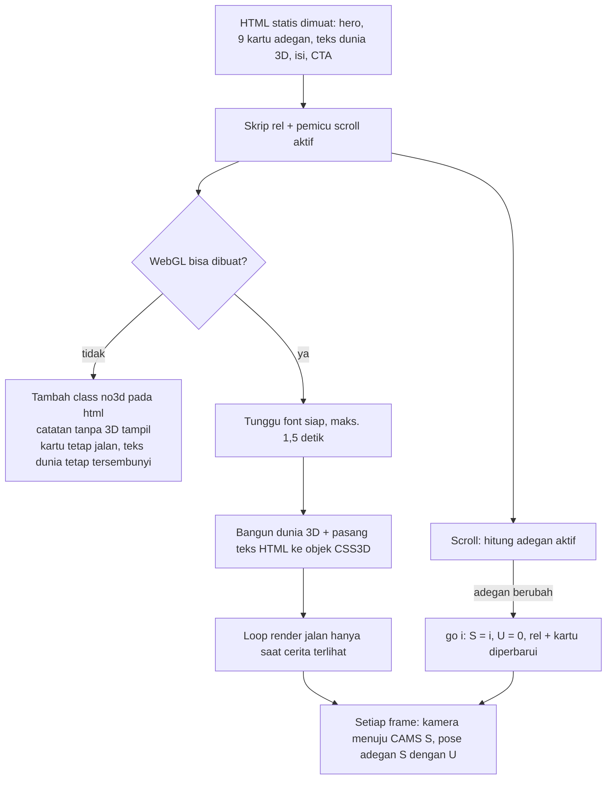
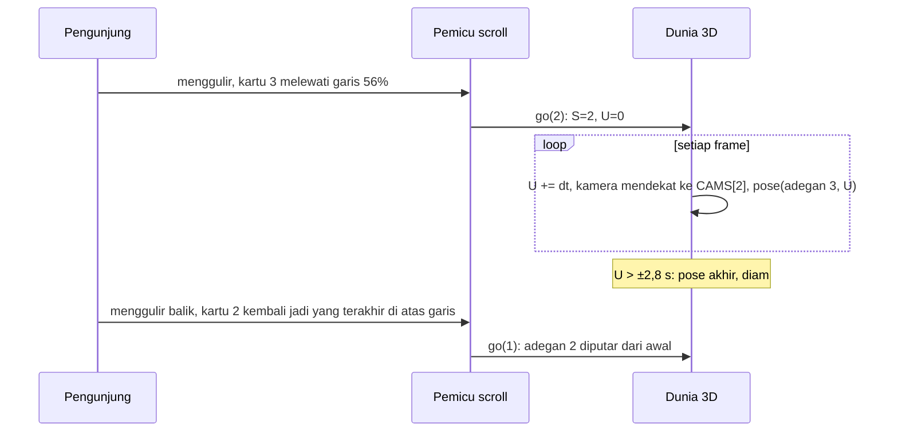
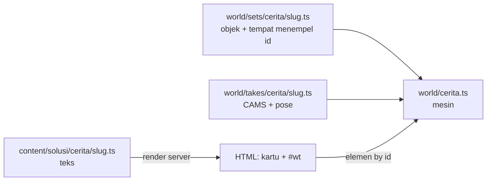

# Halaman detail solusi v1 (Order Grup): logika dan perilaku

| Info | Isi |
|---|---|
| Tanggal | 4 November 2026 |
| Sumber | `prototype/solusi-detail-order-grup-v1.html` (versi final v1 yang disetujui Heru, 4 Nov) |
| Pembaca | Wildan (integrasi ke `kreatekno-website-3d`) |
| Isi | Alur, rumus, timing, dan flowchart (mermaid). Tanpa potongan kode, kecuali nama fungsi/variabel prototipe sebagai penunjuk |
| Dokumen pasangan | `docs/SOLUSI-DETAIL-ORDER-GRUP-V1-VISUAL.md` (ukuran, warna, bentuk, posisi objek), `docs/SOLUSI-DETAIL-ORDER-GRUP-V1-COPY.md` (semua teks) |
| Dokumen lama yang dipakai ulang | `docs/SOLUSI-V1-LOGIKA.md` bagian 12 (pop up kontak) dan 13 (solusi terkait) |
| Kolom "Jenis" | **TETAP** = sama di 12 solusi (kode bersama) · **PER SOLUSI** = isi/angka beda per solusi (data atau file adegan per solusi) |
| Notasi | `W`, `H` = lebar dan tinggi area 3D (`.stage`, px). `VW`, `VH` = lebar dan tinggi viewport. `dt` = selang waktu antar frame (detik, maks. .05). `t` = waktu sejak halaman dibuka (detik). `S` = indeks adegan aktif (0 sampai 8; di dokumen ini "adegan 1" = `S` 0). `U` = detik sejak adegan aktif dimulai. "HP" = lebar viewport ≤ 759 px (`max-width: 759px`). `seg(u, a, b)` = posisi u di antara a dan b, dibatasi 0..1 |

---

## 1. Peta logika ke repo

| Logika | Prototipe | Tempat di repo (usulan) | Jenis |
|---|---|---|---|
| Route halaman detail | (satu file statis) | lab: `site/app/solusi/[slug]/page.tsx` dengan `generateStaticParams()` dari `SOLUSI`. Wildan: `app/[locale]/(pages)/solusi/[slug]/page.tsx` | TETAP |
| Hero, aside, section isi, CTA, terkait | HTML statis | server component, misalnya `site/components/solusi/detail/*.tsx` | TETAP (isi dari data) |
| Cerita: kartu adegan + teks dunia 3D di HTML | `#steps`, `#wt` | server component `CeritaScroll.tsx` (render HTML) + client hook kecil untuk scroll dan rel | TETAP |
| Pemicu scroll, rel titik | `onScroll()`, `go()`, handler `#rail` | client component `CeritaRel.tsx` (atau hook `useCeritaScroll`) | TETAP |
| Mesin 3D cerita (renderer, kamera, CSS3D, loop) | modul `<script type="module">` bagian umum | `site/world/cerita.ts` (entry `mountCerita(stage, adegan)`, dimuat lazy) | TETAP |
| Dunia 3D Order Grup (objek) | bagian `// area 1` sampai `// results` | `site/world/sets/cerita/order-grup.ts` | PER SOLUSI |
| Kamera per adegan | `CAMS` | `site/world/takes/cerita/order-grup.ts` (ekspor `CAMS`) | PER SOLUSI |
| Koreografi per adegan | `pose(dt, t)` | `site/world/takes/cerita/order-grup.ts` (ekspor `pose`) | PER SOLUSI |
| Teks cerita dan teks dunia | HTML | `site/content/solusi/cerita/order-grup.ts` (bagian 13) | PER SOLUSI |
| Pop up kontak | IIFE `open()`/`close()` | komponen bersama dengan etalase (SOLUSI-V1-LOGIKA 12), misalnya `KontakModal.tsx` + `lib/wa.ts` | TETAP |
| Solusi terkait | ditulis tangan | fungsi murni `related(slug)` di `site/lib/solusi/` + tes Vitest (SOLUSI-V1-LOGIKA 13) | TETAP |

Pembagian file per solusi: setiap solusi punya satu file set (objek), satu file take (`CAMS` + `pose`), dan satu file cerita (teks). Mesin di `world/cerita.ts` sama untuk semua.

---

## 2. Alur halaman



Urutan muat di prototipe: semua di satu modul. Rel dan pemicu scroll dibuat **sebelum** 3D, jadi tetap jalan kalau WebGL gagal. Catatan: kalau impor three dari CDN gagal, seluruh modul gagal (termasuk rel). Di website, rel dan pemicu scroll harus di file sendiri, terpisah dari chunk 3D (temuan 16.2).

---

## 3. Pemicu scroll (TETAP)

### 3.1 Struktur

| Bagian | Aturan |
|---|---|
| Section | `#story-body` berisi `.sticky` (area 3D) lalu `ol.steps` (9 kartu) |
| Desktop (> 759 px) | `.sticky` `position: sticky; top: 0; height: 100svh`. `.steps` `margin-top: -100svh` sehingga kartu lewat **di atas** 3D (z-index 4) |
| HP (≤ 759 px) | `.sticky` tinggi `55svh`, z-index 5 (3D di atas). `.steps` tanpa margin negatif, z-index 1, latar putih: kartu lewat **di bawah** 3D lalu masuk ke bawahnya |
| Tinggi tiap adegan | Desktop: kartu 1 dan 9 `min-height: 100svh`, kartu 2 sampai 8 `88svh`. HP: `62svh`, kartu 9 `50svh` |
| Panjang total cerita (desktop) | 100 + 7 × 88 + 100 = 816svh tinggi `.steps`. Area 3D menempel sepanjang `.story-body` |

### 3.2 Rumus adegan aktif

```
garis = H_viewport × (HP ? 0.70 : 0.56)
aktif = indeks terakhir i dengan  kartu[i].top (getBoundingClientRect) < garis
        (kalau tidak ada: 0)
```

- Dihitung di `scroll` (passive), dibatasi satu kali per `requestAnimationFrame`.
- Dipanggil sekali saat halaman dimuat.
- Kalau `aktif ≠ S`, panggil `go(aktif)`.

### 3.3 `go(i)`

| Langkah | Aturan |
|---|---|
| Penjaga | Kalau `i === S` dan `U > 0`: tidak melakukan apa-apa (adegan yang sedang jalan tidak diulang) |
| Mulai adegan | `S = i`, `U = 0`. Adegan diputar dari awal setiap kali masuk, termasuk saat menggulir mundur |
| Rel | Tombol `i` dapat `aria-current="step"`. Tombol `k < i` dapat class `done` (titik hijau) |
| Kartu | Kartu `i` dapat class `on` (ring ungu 2 px), yang lain dilepas |
| Awal halaman | `S = -1`, lalu `go(0)`, lalu `U = 1` (adegan 1 dianggap sudah berjalan, tidak diputar dari nol) |

`U` bertambah `dt` di setiap frame loop 3D. Tanpa 3D, `U` tetap 0 (tidak berpengaruh, karena tidak ada animasi).

### 3.4 Mekanisme: adegan diputar penuh, bukan di-scrub

Scroll hanya **memilih** adegan. Animasi di dalam adegan berjalan menurut waktu (`U`, detik), bukan menurut posisi scroll. Durasi tiap adegan di bagian 7 (2 sampai 3 detik). Setelah selesai, adegan diam di pose akhir sampai adegan lain dipilih.



---

## 4. Rel titik (TETAP)

| Item | Aturan |
|---|---|
| Isi | 9 tombol, dibuat dari daftar label (`RAIL`, = `cerita.scenes[i].rail`). Tiap tombol: label (`.lbl`) + titik (`.dot`) |
| aria-label | "Adegan {n}: {label}" |
| Klik desktop | Gulir sampai **kartu** adegan itu berada di tengah layar: `y = scrollY + kartu.top − (VH − kartu.tinggi) / 2 + 2` |
| Klik HP | Gulir sampai **atas blok** adegan di 60% tinggi layar: `y = scrollY + blok.top − VH × 0.6 + 2` (di atas garis 70%, jadi adegan pasti aktif) |
| Cara gulir | `scrollTo({ behavior: 'smooth' })`, atau `'auto'` kalau reduced motion |
| Hasil | Adegan berganti lewat pemicu scroll biasa (bagian 3), bukan langsung dari klik |
| Label tampil | Desktop: label muncul saat hover, fokus, atau adegan aktif. HP: label disembunyikan |
| Keyboard | Tombol biasa (`<button>`), urutan Tab mengikuti DOM: rel ada di dalam `.stage`, sebelum kartu |

---

## 5. Kamera (mesin TETAP, angka PER SOLUSI)

### 5.1 Rig

| Item | Aturan |
|---|---|
| Kamera | `PerspectiveCamera(fov 32, near .1, far 120)` |
| Parameter per adegan | `look` (titik tujuan x, y, z), `d` (jarak, m), `yaw` (derajat, putar kiri kanan), `pitch` (derajat, dari atas). Opsional `n` = pengganti khusus HP (`look` dan/atau `d`) |
| Posisi kamera | `x = look.x + sin(yaw) × cos(pitch) × d'`, `y = look.y + sin(pitch) × d'`, `z = look.z + cos(yaw) × cos(pitch) × d'`, lalu `lookAt(look)` |
| Jarak efektif | `d' = d × fit` |
| `fit` | `fa = lebarBebas / H`. `fit = fa < 1.1 ? (1.1 / fa)^0.85 : 1` |
| Perpindahan | Setiap komponen (`look.x/y/z`, `d'`, `yaw`, `pitch`) mendekat ke target dengan `k = 1 − e^(−2.2 × dt)` per frame (redaman, tanpa durasi tetap; ±1,4 detik untuk 95% jalan). Reduced motion: `k = 1` (langsung) |

### 5.2 Geser proyeksi (view offset)

Tujuan: titik `look` tampil di tengah **area bebas**, bukan di tengah layar, tanpa memutar kamera.

| Ukuran | Rumus |
|---|---|
| Desktop | `kananKartu = kartu[0].right` (px dari kiri). `lebarBebas = max(300, W − kananKartu − 70)`. `geserX = (kananKartu + W − 70) / 2 − W / 2`. 70 px = ruang rel di kanan |
| HP | `lebarBebas = W`. `geserY = nav.bottom / 2` (pusat adegan turun setengah tinggi header) |
| Pasang | `camera.setViewOffset(W, H, −geserX, −geserY, W, H)`; kalau dua-duanya 0: `clearViewOffset()`. Dihitung ulang hanya kalau angkanya, `W`, atau `H` berubah |
| CSS3D | `CSS3DRenderer` three 0.186+ membaca `camera.view` dan menggeser lapisan HTML dengan angka yang sama (sudah dicek di sumber 0.186.1) |

Contoh hasil (dihitung dari rumus, kartu kiri 370 px): VISUAL bagian 8.3 memuat angka terukur per viewport.

### 5.3 Tabel kamera Order Grup (PER SOLUSI)

| Adegan | `look` (x, y, z) | `d` | `yaw` | `pitch` | Pengganti HP (`n`) | Fokus |
|---|---|---|---|---|---|---|
| 1 Sebelum | (−6.5, 2.4, .1) | 10 | 8 | 11 | – | Papan grup + pesan berantakan + admin |
| 2 Pesan masuk | (−6.0, 2.35, .1) | 8.3 | 4 | 9 | – | Papan grup, bubble Andi masuk |
| 3 AI membaca | (−1.3, 1.6, −.2) | 8.4 | 0 | 12 | – | Asisten + tumpukan balok data |
| 4 Tersimpan | (2.0, 1.6, −.6) | 8.0 | −4 | 12 | look (2.6, 1.8, −.6), d 6.6 | Tabel order |
| 5 Konfirmasi | (−4.1, 2.45, −.1) | 9.6 | 8 | 9 | – | Balasan dari asisten ke papan |
| 6 Status | (3.8, 1.6, .9) | 8.8 | −14 | 13 | look (3.7, 1.6, 1.1), d 9.6 | Kurir + tabel + mobil |
| 7 Rekap | (7.3, 1.8, −.4) | 7.4 | −10 | 10 | look (7.9, 2.0, −.3), d 6.0 | Rumah + HP pemilik |
| 8 Hasil | (−5.6, 3.0, .4) | 13 | 6 | 12 | – | Kartu angka + admin |
| 9 Untuk Anda | (−.4, 2.0, .6) | 19 | 6 | 28 | – | Seluruh dunia |

Kamera awal (sebelum frame pertama) = adegan 1.

---

## 6. Teks HTML di dunia 3D (mesin TETAP)

### 6.1 Cara menempel

| Item | Aturan |
|---|---|
| Sumber | Elemen di `#wt` (HTML awal). Setiap elemen dibungkus `CSS3DSprite` (selalu menghadap kamera) atau `CSS3DObject` (datar, menempel di papan) |
| Skala dasar | `K = 0.0042` m per px CSS. Skala objek = `K × k × s × boost` |
| `k` | Pengali tetap per elemen (VISUAL 9.4). Untuk tabel dan rekap, `k` dihitung supaya lebar HTML pas dengan papan/HP: tabel `k = (3.7 − .14) / (820 × K)`, rekap `k = 1.26 / (300 × K)` |
| `s` | Skala animasi (0..1+, dipakai pop dan perjalanan) |
| `boost` | HP: 1.35 untuk sprite (bubble dan label). Objek datar tidak diberi boost |
| Tampil | `visible = vis > .02`. `opacity` elemen = `vis` (3 desimal) setiap frame. CSS3DRenderer memberi `display: none` saat tidak terlihat |
| Pointer | Semua elemen `pointer-events: none` (konstruktor CSS3DObject memberi `auto`, jadi ditimpa) |
| Urutan gambar | WebGL dulu, lalu CSS3D. Lapisan CSS3D `position: absolute; inset: 0` di atas canvas. Akibatnya teks HTML **selalu di depan** objek 3D (tidak bisa tertutup) |
| Font | 3D dibangun setelah `document.fonts.ready` (maks. 1,5 detik) supaya lebar teks tidak meloncat |

### 6.2 Bantuan animasi

| Nama | Rumus | Dipakai untuk |
|---|---|---|
| `seg(u, a, b)` | `clamp((u − a) / (b − a), 0, 1)` | Potong waktu adegan |
| `ease(x)` | `1 − (1 − x)³` | Gerak keluar halus |
| `pop(x)` | `1 + 2.6 × (x − 1)³ + 1.6 × (x − 1)²` (x dibatasi 0..1, back-out, puncak ±1.1) | Muncul memantul |
| `arc(a, b, k, angkat)` | lerp a ke b sebesar k, ditambah `y + sin(k × π) × angkat` | Benda terbang melengkung |
| `damp(a, b, laju, dt)` | `a + (b − a) × (1 − e^(−laju × dt))`. Reduced motion: langsung `b` | Semua pergeseran halus |
| `fade(o, nyala, dt, laju = 8)` | `vis` didamp ke 1 atau 0 | Muncul/hilang label |

---

## 7. Koreografi per adegan (PER SOLUSI, contoh Order Grup)

Waktu dalam detik sejak adegan mulai (`U`). Reduced motion: `U` dianggap 99 (semua langsung di pose akhir). Kolom "Akhir" = keadaan setelah animasi selesai.

### 7.1 Adegan 1 · Sebelum (`S` 0)

| Waktu | Kejadian |
|---|---|
| terus | 6 bubble `w-m0..5` melayang di posisi `MESSY` (VISUAL 9.5), skala 1.1, miring `rotation2D` per bubble, naik turun `sin(t × .9 + i) × .04` m |
| terus | Label "Belum dicatat" menempel di bubble `w-m2` (+.55, +.38, +.1), "Terlewat" di `w-m4` (+.6, +.38, +.1) |
| terus | Label "66 order hari ini…" tampil di atas papan |
| terus | Layar laptop admin: nama "Bu Ri" diketik ulang huruf demi huruf, `jumlahHuruf = 1 + (U × 2.2) mod 5` |
| terus | Label "Admin · mengetik ulang ke Excel" tampil; tutup laptop terbuka (−.15 rad) |
| Keluar | Saat pindah adegan, 3 bubble pertama mengecil ke 0 dan hilang; 3 bubble terakhir pindah ke slot papan (laju 5) |

### 7.2 Adegan 2 · Pesan masuk (`S` 1)

| Waktu | Kejadian |
|---|---|
| 0 | Bubble `w-m3..5` di slot papan (skala 1), lurus |
| .3 → 1.5 | Bubble target (Andi) terbang dari atas kepala Andi (−6.3, 1.9, 1.6) ke slot target (`TSLOT`), lengkung angkat .6 m, skala .5 → .9, `ease` |
| Akhir | Bubble target diam di slot target |

### 7.3 Adegan 3 · AI membaca (`S` 2)

| Waktu | Kejadian |
|---|---|
| .3 → 1.5 | Bubble target terbang dari slot ke mulut asisten (−1.6, .95, .15), angkat 1.0 m, skala .9 → .18. Hilang saat sampai |
| 1.2 → 2.6 | "Membaca": wajah asisten menyala (emissive .25 → .8, laju 6), bola antena kuning `#FFD983`, badan bergetar `|sin(t × 8)| × .03` m |
| 1.3 | Label "AI memisahkan data" muncul (fade) |
| 1.4 + i × .16 → 2.1 + i × .16 | Balok data ke-i (i 0..4) keluar dari mulut ke tumpukan di kanan asisten, `pop` |
| Akhir | 5 balok bertumpuk (VISUAL 9.5), label tampil |
| terus | Mata berkedip saat `sin(t × 1.7) > .97` (skala y .2). Mati saat reduced motion |

### 7.4 Adegan 4 · Tersimpan (`S` 3)

| Waktu | Kejadian |
|---|---|
| .3 + i × .1 → 1.3 + i × .1 | Balok ke-i terbang dari tumpukan ke baris tabel (`rowTarget`), angkat .8 m, skala 1 → .4, hilang saat sampai |
| 1.35 | Baris 0412 muncul di tabel (class `hide` dilepas), disorot (class `new`) |
| 1.6 | Label 'Revisi "jadi 12 dus ya"…' muncul di bawah papan |
| Akhir | Baris 0412 status "Baru" |

### 7.5 Adegan 5 · Konfirmasi (`S` 4)

| Waktu | Kejadian |
|---|---|
| .3 → 1.5 | Balasan "Asisten Order" terbang dari mulut asisten ke slot balasan di papan (`RSLOT`), angkat .9 m, skala .5 → 1 |
| 1.6 | Label "Tercatat" muncul di atas kepala Andi; label nama Andi disembunyikan |
| Akhir | Balasan di papan. Tetap tampil di adegan 6 dan 7 |

### 7.6 Adegan 6 · Status (`S` 5)

| Waktu | Kejadian |
|---|---|
| .2 → .7 | Bubble "kirim 0412" muncul (`pop`) di kanan Bayu |
| 1.15 | Status baris 0412: Baru → **Dikirim** |
| 1.2 → 2.4 | Mobil kurir maju +1.6 m (sumbu x), `ease` |
| 1.6 → 2.1 | Bubble "selesai 0412" muncul di bawah bubble pertama |
| 2.55 | Status: Dikirim → **Selesai** |
| Akhir | Dua bubble kurir tampil, status Selesai, mobil di x 5.7 |
| Keluar | Bubble kurir hilang. Mobil tetap maju di adegan berikutnya, mundur lagi kalau kembali ke adegan ≤ 5 (laju 4) |

Baris 0412 disorot (class `new`) di adegan 4 dan 6 saja.

### 7.7 Adegan 7 · Rekap (`S` 6)

| Waktu | Kejadian |
|---|---|
| 0 → ±1.5 | Langit berubah ke malam: `e` didamp ke 1 (laju 3). Latar = campuran `#E9E4F8` ke `#3B3F86` sebesar `e`. Hemisphere 1.55 − .75e, matahari 2.1 − 1.5e, jendela rumah menyala 1.2e, bulan tampil kalau `e > .05` |
| 0 | Label "Pukul 21.00" muncul |
| .4 → 1.6 | Amplop terbang dari tabel (2.6, 1.8, −1.1) ke HP pemilik, angkat 1.4 m, berputar 3 rad. Tampil hanya saat sedang terbang |
| 1.4 → 2.0 | HP pemilik muncul (`pop`, skala 0 → 1, laju 10) dengan rekap HTML menempel di layarnya |
| terus | HP selalu menghadap kamera (putar sumbu y saja) |
| Keluar | Langit kembali siang. HP tetap tampil di adegan 8 dan 9 |

### 7.8 Adegan 8 · Hasil (`S` 7)

| Waktu | Kejadian |
|---|---|
| 0 | 3 kartu angka muncul (fade laju 6, skala ikut opacity), label "Angka contoh" muncul |
| .3 → 1.8 | Angka hitung naik dari 0 ke nilai akhir: `round(nilai × ease(seg(U, .3, 1.8)))` |
| 0 | Tutup laptop admin menutup (1.45 rad, laju 5), tumpukan kertas hilang, label admin berganti "Admin melayani pelanggan", bubble "Halo Bu…" muncul |
| terus | Kartu angka naik turun `sin(t × 1.1 + i) × .04` m dan menghadap kamera (sumbu y) |

### 7.9 Adegan 9 · Untuk Anda (`S` 8)

| Waktu | Kejadian |
|---|---|
| 0 → ±1.4 | Kamera mundur ke pandangan seluruh dunia (d 19, pitch 28) |
| – | Semua keadaan akhir tetap: tabel Selesai, HP rekap, kartu angka (angka langsung nilai akhir), admin melayani |
| – | Kartu 9 punya tombol "Konsultasi gratis" |

### 7.10 Ringkasan siapa tampil di adegan mana

| Elemen | 1 | 2 | 3 | 4 | 5 | 6 | 7 | 8 | 9 |
|---|---|---|---|---|---|---|---|---|---|
| Bubble `w-m0..2` | ● | | | | | | | | |
| Bubble `w-m3..5` (berantakan → slot) | ● | ● | ● | ● | ● | ● | ● | ● | ● |
| Label belum dicatat, terlewat, 66 order | ● | | | | | | | | |
| Admin mengetik ulang | ● | ● | | | | | | | |
| Bubble target Andi | | ● | ● (terbang) | | | | | | |
| AI memisahkan data | | | ● | | | | | | |
| Balok data | | | ● | ● (terbang) | | | | | |
| Baris 0412 | | | | ● | ● | ● | ● | ● | ● |
| Label revisi | | | | ● | | | | | |
| Balasan asisten + "Tercatat" | | | | | ● | ● | ● | | |
| Bubble kurir | | | | | | ● | | | |
| Malam, jam, amplop | | | | | | | ● | | |
| HP rekap | | | | | | | ● | ● | ● |
| Kartu angka, angka contoh, admin melayani | | | | | | | | ● | ● |
| Label nama tim, label area, tabel, papan | ● | ● | ● | ● | ● | ● | ● | ● | ● |

---

## 8. Hover dan klik di lantai 3D (TETAP, area PER SOLUSI)

| Item | Aturan |
|---|---|
| Target | 5 lingkaran lantai (`AREAS`), raycast ke mesh lantai saja |
| Hover | Hanya `pointerType === 'mouse'`. Lingkaran naik .03 m (laju 10), kursor `pointer`, tooltip "Lihat: {area}" di `(x + 14, y − 40)` dari kursor, x dibatasi `W − 220` |
| Lepas | `pointerleave`: hover hilang, tooltip hilang |
| Klik | `pointerup` dalam 8 px dari `pointerdown` (bukan geser) + kena lingkaran → klik tombol rel adegan area itu (sama dengan bagian 4) |
| Area → adegan | Grup chat tim → 2, Asisten Order → 3, Tabel order → 4, Kurir → 6, Rumah pemilik → 7 |
| Desktop | Kartu `.steps` `pointer-events: none` kecuali `.card`, jadi lantai bisa disentuh di sela kartu |

---

## 9. Loop render dan kinerja (TETAP)

| Item | Aturan |
|---|---|
| Renderer | `WebGLRenderer({ antialias: true })`, `setPixelRatio(min(dpr, 1.5))`, sRGB, `NeutralToneMapping` exposure .95, bayangan `PCFShadowMap` |
| Bayangan | Satu directional light memberi bayangan, peta 2048 × 2048, kotak kamera bayangan ±11 × ±7 m |
| Loop | `setAnimationLoop(frame)`. Satu frame: hitung `dt` (maks. .05), `U += dt`, cek ukuran, kamera, `pose`, render WebGL, render CSS3D |
| Ukuran | Kalau `W`/`H` `.stage` berubah: `setSize` kedua renderer, `aspect` kamera |
| Jeda | IntersectionObserver pada `#story-body` dengan `rootMargin: 200px 0px`: loop berhenti saat cerita jauh dari layar. Juga berhenti saat tab tersembunyi (`visibilitychange`) |
| Layar laptop | `CanvasTexture` 400 × 260 digambar ulang setiap frame hanya di adegan 1 |
| Usulan website | Muat chunk 3D (three + CSS3DRenderer + dunia) **lazy** saat `#story-body` mendekati layar, seperti etalase. Anggaran 3D per halaman detail: belum ditetapkan (temuan 16.5) |

---

## 10. Pop up kontak (TETAP)

Sama dengan etalase (SOLUSI-V1-LOGIKA 12). Ringkasan perilaku di prototipe ini:

| Item | Aturan |
|---|---|
| Pemicu | Klik elemen apa pun dengan `[data-contact]` (header, hero, kartu adegan 9, CTA) |
| Pesan | `data-msg` elemen kalau ada; kalau tidak, pesan detail: `Halo Kreatekno, saya lihat solusi "{title}". Saya mau konsultasi solusi serupa untuk bisnis saya.` Di prototipe tidak ada tombol dengan `data-msg`, jadi semua tombol memakai pesan detail |
| Link | WhatsApp `https://wa.me/{nomor}?text={pesan}`. Email `mailto:{alamat}?subject=Konsultasi%20gratis&body={pesan}`. Instagram `https://ig.me/m/{akun}` (tetap). Semua di-`encodeURIComponent` |
| Buka | Ingat elemen yang fokus, tampilkan modal, fokus ke tombol X |
| Tutup | Tombol X, klik latar gelap (bukan kartu), atau Esc. Fokus kembali ke tombol pembuka |
| Jebakan fokus | Tab dan Shift+Tab berputar di antara tombol dan link di dalam kartu |
| Target | WhatsApp dan Instagram `target="_blank" rel="noopener"`. Email tanpa target |

---

## 11. Reduced motion dan tanpa WebGL

| Keadaan | Perilaku |
|---|---|
| `prefers-reduced-motion: reduce` | Scroll tetap memilih adegan. Setiap adegan langsung di pose akhir (`U` = 99, `damp` langsung, kamera langsung). Melayang, kedip, getar, naik turun kartu angka: mati. Klik rel: `scrollTo` tanpa smooth. Semua transisi CSS 1 ms |
| WebGL gagal dibuat | `html.no3d`, catatan "Browser ini tidak bisa menampilkan 3D…" tampil di bawah area 3D. Kartu dan rel tetap jalan. Teks dunia 3D tetap di HTML (tersembunyi visual) |
| JavaScript mati | Semua teks tampil di HTML. Area sticky kosong (latar ungu muda), kartu bisa dibaca. Rel tidak ada (dibuat oleh skrip) |

---

## 12. Aksesibilitas dan keyboard

| Item | Aturan |
|---|---|
| Struktur | Satu H1 (judul solusi). H2 per section. Kartu adegan `<li><article>` di `<ol>`, judul `<h3>` |
| Canvas | `aria-hidden="true"` |
| Teks dunia 3D | Ada di HTML awal di `#wt` (`aria-label`). Setelah 3D jalan, elemen pindah ke lapisan CSS3D (`aria-hidden="false"`), tetap terbaca pembaca layar |
| Rel | `<nav aria-label="Lompat ke adegan">`, `<button>` dengan `aria-current="step"` |
| Fokus | Outline 3 px violet, offset 3 px, radius 8 di semua elemen fokus |
| Pop up | `role="dialog"`, `aria-modal="true"`, `aria-labelledby` judul. Fokus dijebak |
| Temuan | Pembaca layar membaca semua teks dunia 3D (±50 elemen) sekaligus di dalam section cerita. Usulan: bungkus dengan `aria-describedby` atau beri judul pendek (temuan 16.6) |

---

## 13. Bentuk data usulan (PER SOLUSI)

Teks cerita harus ada di HTML awal (dibaca Google, Bing, GPTBot, ClaudeBot, PerplexityBot yang tidak menjalankan JavaScript). Karena itu teksnya **data**, bukan kode 3D.

### 13.1 Tambahan di `items/<slug>.ts` (`SolusiText`)

| Field | Tipe | Aturan validasi usulan | Isi Order Grup |
|---|---|---|---|
| `painsLead` | string | wajib | COPY 8.1 |
| `built` | `{ h, lead, points[] }` | wajib, `points` 2 sampai 6 | COPY 8.2 |
| `quote` | `{ text, by }` | opsional, hanya `status: "jalan"` (tambah ke `superRefine`) | COPY 8.4 |

### 13.2 File baru `cerita/<slug>.ts`

| Field | Tipe | Aturan validasi usulan |
|---|---|---|
| `intro` | string | wajib |
| `scenes` | `{ rail, eb, h, p, cta? }[]` | 5 sampai 9 item. `rail` maks. ±14 huruf (muat di rel). Tepat satu `cta: true`, di item terakhir |
| `areas` | `{ name, scene }[]` | `scene` = indeks adegan yang ada |
| `world` | `Record<id, …>` | Setiap id dipakai oleh file set 3D solusi itu (cek di tes: id di data = id di set) |

### 13.3 Kaitan dengan file 3D



Solusi tanpa file cerita (11 solusi lain sampai dibuat): usulan tampilkan daftar `steps` lama sebagai pengganti section cerita (temuan 16.1).

---

## 14. Solusi terkait (TETAP)

Rumus SOLUSI-V1-LOGIKA 13: untuk setiap solusi lain, skor = 2 × jumlah tim yang sama + jumlah industri yang sama. Ambil 2 tertinggi; seri diurutkan menurut urutan katalog (`SOLUSI`: "Sudah berjalan" dulu, lalu "Siap dibuat").

Hasil untuk `order-grup` (tim operasional, penjualan · industri logistik, retail):

| Solusi | Tim sama | Industri sama | Skor |
|---|---|---|---|
| asisten-sop | 1 (operasional) | 2 | **4** |
| stok-menipis | 1 (operasional) | 2 | **4** |
| booking-jasa | 1 | 0 | 2 |
| berkas-dokumen | 1 | 0 | 2 |
| followup-prospek | 1 (penjualan) | 0 | 2 |
| rekap-penjualan | 0 | 2 | 2 |
| riset-konten, pengingat-tagihan, carousel-konten, ulasan-pelanggan | 0 | 1 | 1 |
| cs-klinik | 0 | 0 | 0 |

Hasil rumus: **asisten-sop** dan **stok-menipis**. Prototipe menulis tangan `rekap-penjualan` + `stok-menipis` (temuan 16.3).

---

## 15. Daftar event listener

| Event | Elemen | Opsi | Fungsi |
|---|---|---|---|
| `scroll` | window | passive | Pemicu adegan (dibatasi rAF) |
| `click` | `#rail` | | Gulir ke adegan |
| `pointermove` | canvas | | Hover lantai (mouse saja) |
| `pointerleave` | canvas | | Lepas hover |
| `pointerdown` / `pointerup` | canvas | | Klik lantai (beda ≤ 8 px) |
| IntersectionObserver | `#story-body` | rootMargin 200px 0px | Jalankan/hentikan loop |
| `visibilitychange` | document | | Hentikan loop saat tab tersembunyi |
| `click` | document | | `[data-contact]` membuka pop up |
| `click` | `#ct-x`, `#contact` | | Tutup pop up |
| `keydown` | document | | Esc dan Tab di pop up |
| `change` (media query) | – | – | **Tidak ada.** `narrow` dibaca ulang setiap frame, garis scroll dibaca setiap scroll |

---

## 16. Temuan logika (bahan keputusan, prototipe tidak diubah)

| No | Temuan | Usulan |
|---|---|---|
| 16.1 | Hanya Order Grup yang punya dunia 3D. 11 solusi lain belum punya cerita | Halaman detail tetap bisa dibuat untuk semua: section cerita diganti daftar `steps` sampai dunianya dibuat |
| 16.2 | Rel dan pemicu scroll ada di modul yang sama dengan impor three dari CDN. Kalau chunk 3D gagal dimuat, rel ikut hilang | Pisahkan: client component kecil untuk scroll + rel, chunk 3D lazy terpisah |
| 16.3 | Solusi terkait di prototipe ditulis tangan dan tidak sama dengan rumus | Ikuti rumus (bagian 14) |
| 16.4 | Aturan repo `CLAUDE.md`: "Label dan glyph memakai CanvasTexture". Halaman ini sengaja memakai **HTML (CSS3DRenderer)** untuk teks di 3D, supaya terbaca mesin pencari dan AI (permintaan Heru 4 Nov) | Catat pengecualian ini di `docs/KEPUTUSAN.md`. CSS3DRenderer ada di paket `three` (addons), tanpa paket npm baru |
| 16.5 | Versi three: prototipe 0.186.1 (aturan CDN artifact), repo 0.187.0. `PCFShadowMap` dan `CSS3DRenderer` dengan view offset ada di keduanya | Pakai 0.187.0 di repo, cek ulang render. Tetapkan anggaran 3D halaman detail di KEPUTUSAN (VISUAL 13 memuat angka terukur) |
| 16.6 | Semua teks dunia 3D terbaca pembaca layar sekaligus | Pertimbangkan `role="group"` + judul pendek, atau tandai daftar sebagai pelengkap |
| 16.7 | Adegan yang sama tidak diulang (penjaga `U > 0`). Masuk ulang ke adegan lain selalu memutar dari awal, termasuk gulir mundur | Sesuai keputusan "adegan berganti per blok teks". Tetap |
| 16.8 | `go()` dipanggil dengan garis scroll yang dibaca dari `matchMedia` setiap scroll, tanpa listener ganti ukuran. Putar iPad dari tegak ke tidur: adegan dihitung ulang baru saat scroll berikutnya | Tambah `resize` → `onScroll()` di website |
| 16.9 | Variabel tidak terpakai di prototipe: `setScale`, `place`, `right`, `wide` (selalu 1), `statusCell` | Jangan dibawa |
