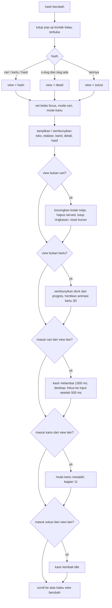
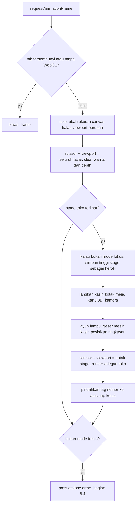
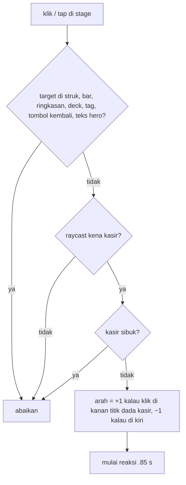
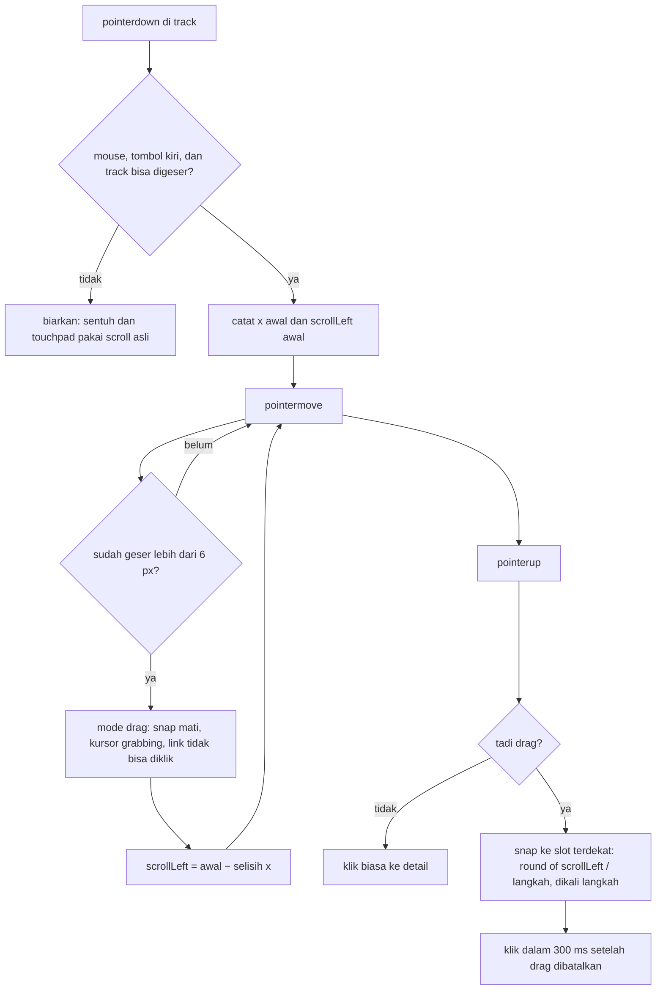
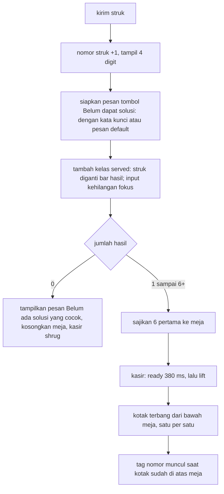
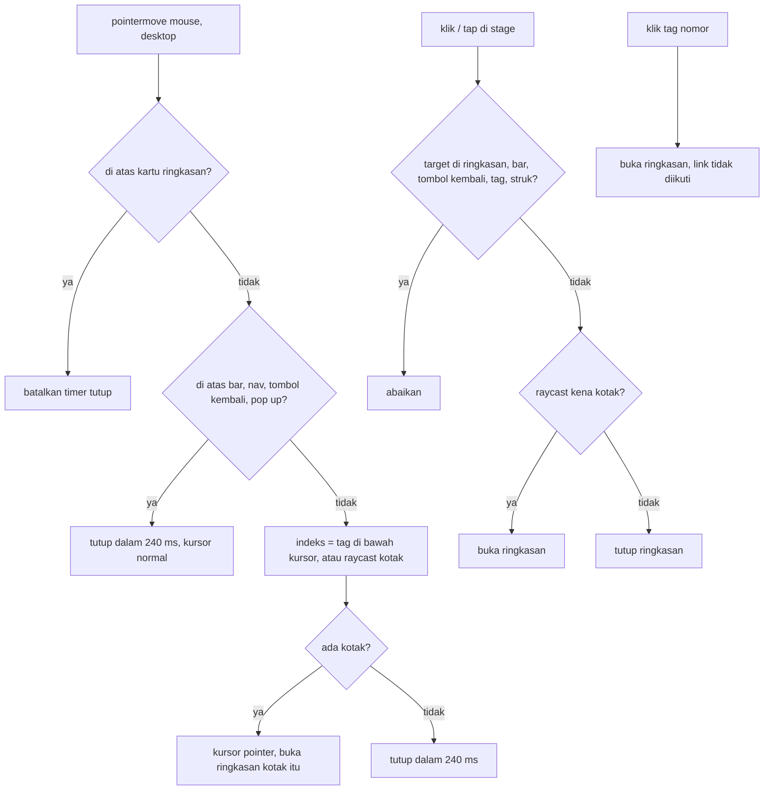
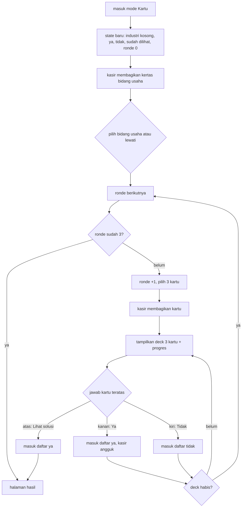

# Halaman Solusi v1: logika dan perilaku

| Info | Isi |
|---|---|
| Tanggal | 4 November 2026 |
| Sumber | `prototype/solusi-etalase-v1.html` (versi final v1 yang disetujui Heru) |
| Pembaca | Wildan (integrasi ke `kreatekno-website-3d`) |
| Isi | Alur, rumus, dan flowchart (mermaid). Tanpa potongan kode |
| Dokumen pasangan | `docs/SOLUSI-V1-VISUAL.md` (ukuran, warna, bentuk), `docs/SOLUSI-V1-COPY.md` (semua teks) |
| Notasi | `W`, `H` = lebar dan tinggi viewport (px). `dt` = selang waktu antar frame (detik, dibatasi maks. .05). `t` = waktu sejak halaman dibuka (detik). `clamp(a, b, x)` = x dibatasi di antara a dan b. "HP" = lebar viewport ≤ 760 px |

---

## 1. Peta logika ke repo

| Logika | Prototipe | Tempat di repo |
|---|---|---|
| Routing dan mode | `onRoute()` (hash) | `app/solusi/page.tsx` + state mode di `components/solusi/Toko.tsx` (`setMode`) |
| Loop render, scissor, ukuran canvas | `frame()`, `size()` | `world/solusi.ts` (`mountToko`) |
| Kamera | `heroTarget()`, `camTarget()`, `stepCam()` | `world/takes/solusi/kamera.ts` |
| Pose kasir, ikut kursor, reaksi dipukul | `kasir`, `stepKasir()`, `look`, `hit` | `world/takes/solusi/kasir.ts` + `world/cast/kasirPose.ts` (GSAP lewat rig, SOLUSI-SPEC bagian 6) |
| Mesin kasir bergeser | `regTargetX()` | `world/takes/solusi/kotak.ts` atau `kamera.ts` |
| Tier etalase, scroll samping, drag, panah | `TIERS`, `syncArrows()`, handler track | `components/solusi/Etalase.tsx` (server) + hook client kecil |
| Kotak 3D etalase (ortho) | `rakFrame()` | `world/solusi.ts` |
| Pencarian dan filter | `searchList()` | `lib/solusi/search.ts` (fungsi murni + tes Vitest) |
| Kotak di meja, tata letak, tag | `counter`, `counterLayout()` | `world/takes/solusi/kotak.ts` |
| Kartu ringkasan | `openSum()`, `placeSum()`, `boxAt()` | `components/solusi/StrukCari.tsx` + raycast di `world/solusi.ts` |
| Pop up kontak | `openContact()` | komponen baru (misalnya `KontakModal.tsx`) + `lib/wa.ts` |
| Kartu masalah: ronde, skor, hasil | `cardScore()`, `pickRound()`, `results()` | `lib/solusi/kartu.ts` (fungsi murni + tes) |
| Kartu masalah: tampilan dan swipe | `renderDeck()`, `decide()`, `bindDrag()` | `components/solusi/DekKartu.tsx` |
| Halaman hasil | `renderHasil()` | `app/solusi/hasil/page.tsx` + `HasilKartu.tsx` |
| Halaman detail, solusi terkait | `renderDetail()`, `related()` | fase 2 Wildan |

---

## 2. Routing dan mode

Prototipe memakai hash. Di website, hash diganti route/state:

| Hash prototipe | View | Usulan di website |
|---|---|---|
| `#solusi` (atau kosong) | toko + etalase + band | `/solusi` |
| `#cari` | toko mode Cari | `/solusi`, state mode `cari` (debug `?mode=cari` sudah ada di SOLUSI-SPEC) |
| `#kartu` | toko mode Kartu | `/solusi`, state mode `kartu` |
| `#hasil` | halaman hasil | `/solusi/hasil?b=<industri>&y=<id,id>&n=<id,id>` (SOLUSI-SPEC 4.6). Di prototipe jawaban disimpan di memori |
| `#s-<slug>` | detail solusi | `/solusi/<slug>` (fase 2). Slug tidak dikenal jatuh ke `#solusi` |

### 2.1 Kelas status

| Kelas | Di | Arti |
|---|---|---|
| `focus` | body | mode Cari atau Kartu. Stage jadi `100svh`, hero hilang, etalase, band dan footer disembunyikan |
| `mode-cari` | body | mode Cari |
| `mode-kartu` | body | mode Kartu |
| `served` | body | di mode Cari, sudah menekan Enter (struk dilipat jadi bar) |
| `no3d` | html | WebGL gagal dibuat |

### 2.2 Saat route berubah

Teks kotak pencarian dan filter **tidak di-reset** saat keluar dari mode Cari.

---

## 3. Loop render

Satu canvas fixed seukuran viewport, transparan, di bawah teks HTML.

| Aturan | Nilai |
|---|---|
| Pixel ratio | `min(devicePixelRatio, 1.5)` di HP, `min(devicePixelRatio, 2)` di desktop. Dihitung ulang hanya saat ukuran viewport berubah |
| `dt` | `min(.05, selang frame)` |
| Terlihat | `rect.bottom > 0` dan `rect.top < H` dan `rect.right > 0` dan `rect.left < W` |
| Viewport stage | x = `rect.left`, y = `H − rect.bottom` (sumbu y WebGL dari bawah) |
| Aspek kamera | `rect.width / rect.height` setiap frame |

Catatan untuk repo: `world/solusi.ts` sudah memakai pola satu canvas + scissor, ditambah pengukur kualitas dan `AMBIENT_FPS`. v1 tidak punya pengukur kualitas.

---

## 4. Kamera

### 4.1 Target

| Kondisi | Target |
|---|---|
| fokus + HP + mode Cari + ada kotak di meja | pos (1.95, 3.45, 4.75), look (1.95, 1.3, −.1), fov 46 |
| fokus + HP | pos (1.95, 4.3, 5.6), look (1.95, 1.45, −.2), fov 46 |
| fokus + desktop | pos (1.4, 3.9, 6.3), look (1.4, 1.35, .15), fov 36 |
| bukan fokus | kamera hero (4.2) |

### 4.2 Kamera hero: bibir meja menempel ke tepi bawah stage

Tujuan: bibir meja (y = .88) selalu tepat 8 px di atas tepi bawah stage, berapa pun tinggi stage, supaya depan meja menyambung ke etalase HTML di bawahnya. Sudut kamera tidak berubah, kamera hanya digeser naik/turun.

| Simbol | Rumus |
|---|---|
| dasar | desktop: pos (.32, 2.3, 6.5), look (.32, 2.12, 0), fov 35 · HP: pos (1.95, 3.1, 7.2), look (1.95, 2.85, 0), fov 41 |
| `LIP_Y` | .88 |
| `LIP_GAP` | 8 px |
| `heroH` | tinggi stage terakhir saat **bukan** mode fokus (px) |
| `dist` | `pos.z − 1.9` (jarak ke bibir meja) |
| `ppu` (px per meter di bibir meja) | `heroH / (2 × dist × tan(fov / 2))` |
| `axis` (tinggi garis pandang di bibir meja) | `pos.y + (look.y − pos.y) × dist / pos.z` |
| `d` (geser) | `LIP_Y + (heroH / 2 − LIP_GAP) / ppu − axis` |
| hasil | `pos.y + d` dan `look.y + d`, x, z dan fov tetap |

Hasil per viewport ada di VISUAL bagian 7.4.

### 4.3 Perpindahan

Setiap frame: `k = 1 − e^(−dt × 3.4)`. Posisi dan titik pandang di-lerp ke target dengan `k`, fov juga. Frame pertama dan reduced motion: `k = 1` (langsung). Ini setara pegas teredam tanpa durasi tetap (sekitar 90% jalan dalam ±.7 s). Repo memakai GSAP tween (SOLUSI-SPEC bagian 6); nilai akhirnya harus sama.

---

## 5. Kasir

### 5.1 Sistem pose

| Konsep | Aturan |
|---|---|
| `base` | pose dasar yang "diinginkan" (idle atau ready) |
| `pose` | pose yang sedang dipakai |
| `want(p)` | `base = p`; kalau tidak sedang menjalankan aksi, `pose = p` |
| `act(p, ms)` | `pose = p` selama `ms` (default 1100; 0 saat reduced motion). Setelah lewat, kembali ke `base` |
| Campur | setiap nilai pose di-lerp ke target dengan `k = 1 − e^(−dt × 9)` (reduced motion: 1) |
| Napas | y pinggul + `sin(t × 1.7) × .012` |
| Kedip | kalau `t mod 4.2 < .12`: skala y mata .15 |
| Menoleh idle | rotasi y kepala `sin(t × .45) × .14` |
| Lambai (wave) | siku kanan + `sin((sekarang − mulai) / 90 ms) × .4` |
| Angguk (nod) | kepala x + `sin((sekarang − mulai) / 110 ms) × .12` |

| Pemicu | Aksi |
|---|---|
| Masuk mode Cari | `act(wave, 1300)` |
| Mengetik di input (ada teks) | `want(ready)` (jongkok) |
| Input kosong lagi | `want(idle)` |
| Fokus ke input yang berisi | `want(ready)` |
| Input kehilangan fokus saat ready | `want(idle)` |
| Enter dengan hasil | `base = idle`, `act(ready, 380)`, lalu setelah 380 ms `act(lift, 260 + n × 160)` |
| Enter tanpa hasil | `act(shrug)` (1100 ms) |
| "Cari kembali" | `act(lift, 520)` |
| Membagikan kertas/kartu | `act(ready, 360)`, lalu setelah 360 ms `act(offer, 700)` |
| Kartu dijawab "Ya" | `act(nod)` |
| Kembali ke etalase | `want(idle)` |

### 5.2 Kepala mengikuti kursor (desktop, semua mode)

Aktif hanya kalau `(hover: hover) and (pointer: fine)` cocok dan event berasal dari mouse. Di tablet dan HP tidak aktif.

| Langkah | Rumus |
|---|---|
| Titik kepala di layar | proyeksikan (x kasir, y pinggul + 1.5, z kasir) ke kamera, lalu ke px stage: `hx`, `hy` |
| Target yaw | `clamp(−.61, .61, (mouseX − hx) / (W × .45) × .61)` (±35°) |
| Target pitch | `clamp(−.26, .26, (mouseY − hy) / (H × .5) × .26)` (±15°) |
| Mati | kursor keluar dokumen, jendela kehilangan fokus, atau stage tersembunyi / sudah di atas layar (target jadi 0) |
| Halus | `yaw += (target − yaw) × (1 − e^(−dt × 7))`, sama untuk pitch |
| Pakai ke kepala | saat aktif: rotasi y kepala = yaw (menggantikan menoleh idle), rotasi x kepala += pitch. Saat mati: menoleh idle masuk lagi pelan, bobot `min(1, |yaw| / .05)` |
| Mata | x mata = ±.09 + yaw × .045, y mata = .02 − pitch × .05 |

Kursor berubah jadi pointer saat berada di atas kasir (raycast ke seluruh mesh kasir), kecuali sedang di atas nav, struk, bar, ringkasan, deck, pop up, teks hero atau tombol kembali.

### 5.3 Reaksi dipukul (klik atau tap kasir)

Kasir sibuk = ada animasi kotak meja **atau** animasi kartu 3D **atau** pose sekarang `ready`, `lift`, atau `offer`.

Reaksi selama `u` = 0 sampai .85 s, ditumpuk di atas pose:

| Bagian | Rumus |
|---|---|
| Amplop | `env = e^(−u × 5.5)` (0 saat reduced motion) |
| Getar | `wob = cos(u × 22)` |
| Pinggul miring | rotasi z = `−arah × .22 × env × wob` |
| Pinggul geser | x = `−arah × .06 × env × wob`, y −= `.04 × env` |
| Badan terdorong | rotasi x pinggul −= `.12 × env` |
| Kepala mendongak | rotasi x kepala −= `.28 × e^(−u × 7)` |
| Kepala miring | rotasi z kepala = `−arah × .3 × env × cos(u × 18 + .6)` |
| Lengan terbuka | bahu kiri z −= `.5 × env`, bahu kanan z += `.5 × env` |
| Mata | terpejam (skala y .12) selama u < .45 |
| Mulut | mulut "O" selama u < .6, lalu senyum lagi |
| Selesai | u ≥ .85: miring dan geser kembali 0 |

Klik baru saat reaksi berjalan memulai ulang reaksi (tidak ditolak, kecuali kasir sibuk).

### 5.4 Mesin kasir bergeser

| Kondisi | Target x |
|---|---|
| bukan mode Cari | .55 (posisi rumah) |
| mode Cari + (HP atau sudah `served`) | x dunia di bawah px −240 (keluar layar kiri) |
| mode Cari desktop sebelum Enter | x dunia di bawah `kiri kertas + 42% lebar kertas` (bersembunyi di belakang kertas struk) |

Halus: `x += (target − x) × (1 − e^(−dt × 4))`. Konversi px → x dunia: raycast dari kamera **target** (bukan kamera yang sedang bergerak) ke bidang z = −.12 pada tinggi meja (y 1.06).

---

## 6. Etalase: tier dan urutan

| Langkah | Aturan |
|---|---|
| Tim tiap solusi | tim pertama (`tim[0]`) |
| Isi tier | semua solusi dengan tim pertama itu; "Sudah berjalan" dulu, lalu "Siap dibuat", urutan data dijaga |
| Urutan tier | jumlah solusi terbanyak dulu; seri diurutkan menurut urutan `TIM` di taksonomi |
| Tier kosong | tidak ditampilkan |
| Slot per tier | minimal 5 (`PER_TIER`). Kalau solusi < 5, sisa diisi slot dekor (tidak bisa diklik, `aria-hidden`) |
| Warna | warna tim (VISUAL 2.3) |

Hasil dengan 12 solusi v1:

| Urutan | Tier | Solusi | Dekor |
|---|---|---|---|
| 1 | Layanan pelanggan | 3 | 2 |
| 2 | Operasional | 3 | 2 |
| 3 | Marketing | 2 | 3 |
| 4 | Penjualan | 1 | 4 |
| 5 | Keuangan & admin | 1 | 4 |
| 6 | Manajemen | 1 | 4 |
| 7 | SDM | 1 | 4 |

Isi tiap tier (slug) bisa diturunkan dari tabel bagian 14 di COPY (kolom "Tim pertama").

---

## 7. Etalase: geser ke samping

### 7.1 Panah

| Aturan | Nilai |
|---|---|
| Tampil | hanya kalau isi track lebih lebar dari track: `scrollWidth > clientWidth + 2`. Di HP panah selalu disembunyikan CSS |
| Nonaktif kiri | `scrollLeft < 4` (tombol jadi transparan, tidak bisa diklik) |
| Nonaktif kanan | `scrollLeft > scrollWidth − clientWidth − 4` |
| Langkah | lebar satu slot + gap kolom (cadangan 220 + 16) |
| Klik | `scrollBy(±langkah)`, halus (langsung saat reduced motion) |
| Dicek ulang | saat track di-scroll dan saat resize |

### 7.2 Drag dengan mouse

Drag bawaan browser untuk link (`dragstart`) dicegah. Scroll snap CSS: `x mandatory`, tiap slot `snap-align: start`.

### 7.3 Hover kotak

Hanya CSS: naik 6 px (200 ms). Pass 3D membaca posisi kotak HTML setiap frame, jadi kotak 3D ikut naik dan bayangan kontaknya mengecil (VISUAL 8.4).

---

## 8. Etalase 3D (pass orthographic)

Kotak 3D digambar tepat di atas kotak HTML. Satuan: 1 unit = 1 CSS px viewport.

| Langkah | Aturan |
|---|---|
| Kamera | ortho kiri 0, kanan W, atas 0, bawah −H. Titik px (x, y) = dunia (x, −y) |
| Lewati | kalau etalase tersembunyi atau di luar layar |
| Cache geometri | kunci = ukuran dibulatkan; kalau cache > 400 bentuk, semua dibuang |
| Ukuran | diambil dari kotak HTML pertama tiap jenis, semua instance diskalakan dari situ |
| Kemiringan | rotasi x .2. Tinggi geometri = tinggi HTML / cos(.2) supaya muka depan pas dengan kotak HTML |
| Posisi instance | pusat = (kiri + lebar/2, −(atas + tinggi/2) − naik, z) |
| Bayangan | lihat VISUAL 8.4. `naik` = jarak dasar slot ke dasar kotak (0 sampai 6 px saat hover) |
| Urutan gambar | 1) papan rak di seluruh section (scissor section, clear depth) 2) per track: scissor = track ∩ jendela rak ∩ section, clear depth, gambar kotak + panel + dekor + bayangan |
| autoClear | dimatikan selama pass, dinyalakan lagi setelahnya |

---

## 9. Pencarian dan filter

### 9.1 Daftar hasil

Sumber: semua solusi, urut "Sudah berjalan" dulu lalu "Siap dibuat" (urutan data dijaga). Solusi lolos kalau **semua** syarat terpenuhi:

| Syarat | Lolos kalau |
|---|---|
| Bidang usaha | filter kosong, atau `industri` solusi berisi nilai filter |
| Tim | filter kosong, atau `tim` solusi berisi nilai filter (semua tim, bukan hanya yang pertama) |
| Aplikasi | filter kosong, atau `apps` solusi berisi nilai filter |
| Status | filter kosong, atau sama |
| Kata kunci | kosong, atau teks gabungan `title + result + question + answer + semua pains` (huruf kecil) **mengandung** kata kunci (huruf kecil, spasi tepi dibuang). Satu frasa utuh, tidak dipecah per kata |

Select yang terisi mendapat gaya aktif. Pencarian hanya jalan saat kirim (Enter / tombol), tidak saat mengetik.

### 9.2 Saat kirim

Hasil lebih dari 6: hanya 6 pertama yang disajikan. v1 **tidak** menampilkan daftar lengkap (beda dengan SOLUSI-SPEC 4.4).

### 9.3 Kotak terbang

| Fase | Dari | Ke | Durasi | Jeda | Busur | Easing |
|---|---|---|---|---|---|---|
| Sajikan | (1.95, .45, −.35) | titik layout, y = 1.06 + .4 × skala / 2 | 560 ms | mulai 420 ms setelah kirim, + 150 ms per kotak | +.55 m × sin(π u) | ease-in-out quad |
| Ambil kembali | posisi sekarang | (1.95, .5, −.4), lalu disembunyikan | 460 ms | serentak | +.35 m | ease-in-out quad |

Reduced motion: durasi 1 ms, tanpa jeda. Kotak yang dipakai ulang dari sajian sebelumnya dibersihkan dari animasi "ambil kembali" supaya tidak ikut tersembunyi.

Tag nomor tampil kalau `y kotak > 1.06 + .4 × skala × .3`. Posisinya diproyeksikan dari (x, y + .4 × skala / 2 + .16, z) setiap frame.

### 9.4 Tata letak kotak di meja

| Langkah | Rumus |
|---|---|
| Baris | `rows = n > 3 ? 2 : 1`, `perRow = ceil(n / rows)` |
| z baris | depan `zF` = .95 (desktop) / .45 (HP); belakang `zB` = .1 / −.3 |
| Area layar (px dari kiri stage) | HP: 22 sampai W − 22 · desktop setelah kirim: W × .1 sampai W × .9 · desktop sebelum kirim: kanan kertas + 28 sampai W − max(28, W × .04) |
| Ke dunia | `xL`, `xR` = x dunia di bawah tepi area, di bidang z = `zF`, tinggi meja, dari kamera **target** |
| Butuh | `need = perRow × .78 + (perRow − 1) × .1 + (rows > 1 ? (.78 + .1) / 2 : 0)` |
| Skala | `sc = clamp(.4, HP ? .72 : .8, (xR − xL) / need)` |
| Jarak | `st = (.78 + .1) × sc`, tengah `cx = (xL + xR) / 2` |
| Lebar baris | `rowW = (perRow − 1) × st + (rows > 1 ? st / 2 : 0)` |
| Kotak ke-i | baris 0 kalau `i < perRow`, kalau tidak baris 1 (`k = i − perRow`). `x = cx − rowW / 2 + k × st + (baris 1 ? st / 2 : 0)`, `z = zF` atau `zB` |
| Resize | 250 ms setelah resize terakhir, kotak dipindah ke layout baru tanpa animasi (kalau tidak sedang beranimasi) |

Contoh hasil (posisi tag di layar) ada di VISUAL 7.5.

### 9.5 "Cari kembali" dan tanpa hasil

| Aksi | Urutan |
|---|---|
| Cari kembali | tutup ringkasan → kotak diambil kembali → kasir `lift` 520 ms → hapus `served` (struk muncul lagi, **isi dan filter tetap**) → reset kursor → desktop: fokus ke input setelah 480 ms |
| Tanpa hasil | bar tetap tampil dengan pesan di atas tombol; tidak ada kotak |
| "Belum dapat solusi" | buka pop up kontak dengan pesan dari 9.2 (COPY 12.2) |

---

## 10. Kartu ringkasan

Aktif hanya kalau mode Cari dan `served`.

| Aturan | Nilai |
|---|---|
| Hover desktop | hanya pointer mouse dan bukan HP. Tablet dan HP membuka lewat tap / klik |
| Keluar dari kartu (mouse) | tutup dalam 240 ms; masuk lagi membatalkan |
| Tombol X (HP) | tutup |
| Esc | tutup pop up kalau terbuka, kalau tidak tutup ringkasan |
| Isi | judul, chip aplikasi, ringkasan pendek (`summary`, cadangan `result`), tombol "Lihat detail" ke detail |
| Posisi desktop | titik atas kotak `(x, y + .4 × skala / 2 + .02, z)` diproyeksikan ke px: `bx`, `by`. `left = clamp(16 + w/2, W − 16 − w/2, bx)`, `top = by − 30`, kartu digeser −50% x dan −100% y. Panah bawah digeser `bx − left` supaya tetap menunjuk kotak |
| Posisi HP | kiri/kanan 16, `bottom = bawah stage − atas bar + 12` |
| Diperbarui | setiap frame selama terbuka (ikut kamera dan resize) |

---

## 11. Kartu masalah

### 11.1 Alur

Total 3 ronde × 3 kartu = 9 kartu. "Lihat solusi" langsung ke hasil kapan saja.

### 11.2 Skor kartu (memilih kartu berikutnya)

Untuk setiap kartu yang belum dilihat:

| Bagian | Nilai |
|---|---|
| Cocok bidang usaha | kartu tanpa industri, atau belum memilih bidang usaha: **+1** · kartu memuat bidang usaha yang dipilih: **+3** · tidak cocok: **−2** |
| Untuk tiap kartu "Ya" | + jumlah tim yang sama + 1.5 × jumlah solusi yang sama |
| Untuk tiap kartu "Tidak" | − 1.5 × jumlah solusi yang sama |
| Topik baru | kalau tidak satu pun solusi kartu ini pernah muncul di kartu yang sudah dijawab: **+.8** |
| Acak | + angka acak 0 sampai .3 (supaya urutan tidak selalu sama) |

### 11.3 Memilih 3 kartu per ronde

1. Urutkan kartu belum dilihat dari skor tertinggi.
2. Ambil berurutan, tapi **lewati** kartu yang solusi utamanya (bobot tertinggi) sudah dipakai kartu lain di ronde ini.
3. Kalau belum 3, isi dari urutan yang sama tanpa syarat itu.
4. Tandai ketiganya sudah dilihat.

### 11.4 Hasil

| Langkah | Rumus |
|---|---|
| Skor solusi | jumlah bobot dari semua kartu "Ya" (termasuk "Lihat solusi") |
| Penalti | untuk kartu "Tidak": solusi yang **sudah** punya skor dikurangi bobot × .5 (solusi yang belum punya skor tidak dibuat negatif) |
| Saring | skor > 0 |
| Persen | `round(skor / max(1, skor tertinggi) × 100)` |
| Urut | skor tertinggi; seri: "Sudah berjalan" dulu |
| Tampil | maksimal 4 |

### 11.5 Contoh (tanpa angka acak)

Bidang usaha Retail & F&B. Jawaban: ronde 1 Ya, Tidak, Ya · ronde 2 Ya, Tidak, Tidak · ronde 3 Tidak, Ya, Tidak.

| Ronde | Skor tertinggi | Kartu yang keluar | Jawaban |
|---|---|---|---|
| 1 | k1, k2, k3, k5, k6, k11 = 3.8 (3 bidang usaha + .8 topik baru) | k1, k3, k5 (k2 dilewati: solusi utamanya order-grup, sama dengan k1) | k1 Ya, k3 Tidak, k5 Ya |
| 2 | k6 = 7.0, k24 = 5.0, k17 = 4.8, k20 = 4.8 | k6, k17, k20 | k6 Ya, k17 Tidak, k20 Tidak |
| 3 | k24 = 9.0, k4 = 6.0, k22 = 5.8 | k24, k4, k22 | k24 Tidak, k4 Ya, k22 Tidak |

| Solusi | Dari "Ya" | Penalti "Tidak" | Skor | Persen |
|---|---|---|---|---|
| cs-klinik | k5 3 + k6 3 + k4 2 = 8 | k24 2 × .5 = 1 | 7 | 100% |
| booking-jasa | k5 2 + k6 1 + k4 3 = 6 | k24 1 × .5 = .5 | 5.5 | 79% |
| order-grup | k1 3 = 3 | k3 .5 + k24 .5 = 1 | 2 | 29% |

### 11.6 Swipe / drag kartu

| Aturan | Nilai |
|---|---|
| Hanya kartu teratas | kartu kedua dan ketiga tidak menerima input |
| Saat drag | kartu = `translate(dx, dy) rotate(dx / 18 derajat)`, tanpa transisi |
| Stempel Ya | opacity `clamp(0, 1, dx / 90)` |
| Stempel Tidak | opacity `clamp(0, 1, −dx / 90)` |
| Stempel Lihat solusi | opacity `clamp(0, 1, −dy / 90)` kalau `|dx| < 60`, kalau tidak 0 |
| Ambang | `w = min(110, lebar kartu × .28)` |
| Lepas | `dx > w` → Ya · `dx < −w` → Tidak · `dy < −w` dan `|dx| < 60` → Lihat solusi · lainnya kembali ke tengah (380 ms) |
| Keyboard | panah kanan = Ya, kiri = Tidak, atas = Lihat solusi (saat mode Kartu dan ada kartu) |
| Tombol | **tidak ada** di v1 (penanda hanya petunjuk, keputusan Heru). Beda dengan SOLUSI-SPEC 4.5 |
| Keluar | Ya `translate(140%, −6%) rotate(18°)`, Tidak `translate(−140%, −6%) rotate(−18°)`, Lihat solusi `translate(0, −140%)`, opacity 0, stempel penuh. 300 ms (10 ms reduced motion), lalu kartu berikutnya naik |
| Kunci | selama 300 ms itu jawaban baru diabaikan |
| Fokus | kartu teratas mendapat fokus keyboard setiap kali siap |

### 11.7 Kartu 3D yang dibagikan kasir

| Item | Nilai |
|---|---|
| Mulai | 360 ms setelah aksi (kasir `ready` lalu `offer`) |
| Dari | (1.95, .5, −.35), miring x −1.1 |
| Ke | desktop (1.4, 1.08, .9) · HP (1.95, 1.08, .6) |
| Durasi | 620 ms, ease-out cubic |
| Busur | +.6 m × sin(π u), putar z sin(π u) × .25, miring x kembali ke 0 |
| Setelah | 120 ms kemudian kartu 3D disembunyikan dan kertas / deck HTML tampil |
| Tanpa WebGL atau reduced motion | langsung tampil HTML |

### 11.8 Halaman hasil

| Item | Aturan |
|---|---|
| Daftar | `results()` (11.4) |
| Masalah dipilih | teks kartu "Ya" tanpa tanda tanya |
| Pesan WA | COPY 12.3: menyebut bidang usaha (kalau ada) dan daftar masalah per baris; tanpa jawaban "Ya" memakai pesan default |
| Ulangi | kembali ke mode Kartu (state baru) |
| Tanpa state (dibuka langsung) | di prototipe: tidak ada hasil, judul "belum ada". Di website: baca dari query string (SOLUSI-SPEC 4.6) |

---

## 12. Pop up kontak

| Item | Aturan |
|---|---|
| Pemicu | semua elemen dengan atribut `data-contact` (nav, band, "Belum dapat solusi", hasil, detail). Pesan dari `data-msg`, kalau kosong pesan default |
| WhatsApp | `https://wa.me/<nomor>?text=<pesan ter-encode>` (tab baru). Repo: `waHref()` di `lib/wa.ts` |
| Instagram | `https://ig.me/m/<akun>` (tab baru, tanpa pesan) |
| Email | `mailto:<email>?subject=Konsultasi%20gratis&body=<pesan>` |
| Buka | simpan elemen yang sedang fokus, tampilkan, fokus ke tombol X |
| Fokus terkunci | Tab dari elemen terakhir ke pertama, Shift+Tab sebaliknya |
| Tutup | klik latar, tombol X, Esc, atau route berubah. Fokus kembali ke elemen asal |
| Analitik | prototipe tidak mengirim event. `WhatsAppButton` Wildan memanggil `trackWhatsApp(section, intent, locale)`; perlu diputuskan apakah event dikirim per kanal |
| Kontak | nomor, akun, email masih contoh (GANTI) |

---

## 13. Halaman detail (acuan fase 2)

| Item | Aturan |
|---|---|
| Section | masalah, cara kerja (langkah), sebelum-sesudah (tabel), cocok/tidak cocok, persiapan, hasil (hanya "Sudah berjalan" dengan `metrics`), aplikasi, FAQ, CTA, solusi terkait |
| Catatan aside | "Sudah berjalan": disamarkan; "Siap dibuat": ide |
| Solusi terkait | untuk setiap solusi lain: skor = 2 × jumlah tim yang sama + jumlah industri yang sama. Ambil 2 tertinggi (seri: urutan data) |
| Pesan WA | COPY 12.4 |
| Judul tab | "{title} \| Kreatekno Solusi" |

---

## 14. Aksesibilitas dan keyboard

| Item | Aturan v1 |
|---|---|
| Canvas | `aria-hidden` |
| Kotak etalase | link `<a>` dengan judul sr-only + teks sampul; ikon aplikasi `role="img"` dengan label |
| Slot dekor | `aria-hidden`, tidak bisa difokus |
| Panah rak | `<button>` dengan label "Geser rak {tim} ke kiri/kanan" |
| Struk | `<form role="search">`, label untuk input dan 4 select (sr-only) |
| Bar hasil | `role="region"`, `aria-live="polite"` |
| Ringkasan | `role="dialog"` dengan label "Ringkasan {judul}" (tidak modal) |
| Pop up | `role="dialog" aria-modal="true"`, fokus terkunci |
| Kartu teratas | `tabindex 0`, `role="group"`, `aria-roledescription="kartu masalah"`; kartu lain `aria-hidden` |
| Penanda kartu | `aria-hidden` |
| Keterbatasan v1 | kartu masalah hanya bisa dijawab dengan swipe/drag atau panah keyboard; belum ada alternatif untuk pembaca layar (keputusan Heru untuk v1) |
| Esc | tutup pop up, kalau tidak ada, tutup ringkasan |

---

## 15. Reduced motion dan tanpa WebGL

| Kondisi | Perilaku |
|---|---|
| `prefers-reduced-motion: reduce` | CSS: transisi 1 ms, animasi mati. JS: kamera, kasir dan mesin kasir langsung ke target, aksi kasir 0 ms, tanpa napas / menoleh / ayun lampu, reaksi dipukul tanpa gerak, kotak meja 1 ms, kartu 3D dilewati, scroll panah langsung, keluar kartu 10 ms |
| WebGL gagal | kelas `no3d`: stage dan etalase memakai CSS polos (VISUAL 8.5), tanpa loop render. Struk, kartu, ringkasan tidak punya kotak 3D (tag dan ringkasan kotak tidak tersedia) |
| Tab tersembunyi | frame dilewati |

---

## 16. Daftar event listener

| Event | Di | Untuk |
|---|---|---|
| `hashchange` | window | routing |
| `resize` | window | ukuran canvas, panah rak, layout kotak meja (debounce 250 ms) |
| `pointermove` | window | kepala kasir, kursor kasir, ringkasan hover, drag rak |
| `pointerup` | window | akhir drag rak |
| `pointerdown`, `scroll`, `click` (capture) | tiap track | drag rak, sync panah, batalkan klik setelah drag |
| `click` | stage | reaksi dipukul, buka / tutup ringkasan |
| `click` | dokumen | `data-contact` → pop up |
| `click`, `keydown` (Tab) | pop up | tutup, fokus terkunci |
| `keydown` | dokumen | Esc; panah untuk kartu |
| `pointerdown/move/up/cancel` | kartu teratas | swipe |
| `input`, `focus`, `blur` | input struk | pose kasir |
| `change` | 4 select | gaya filter aktif |
| `submit` | struk | pencarian |
| `pointerenter/leave`, `click` | ringkasan | jaga terbuka, tutup |
| `mouseleave` | dokumen | kepala kasir berhenti mengikuti |
| `blur` | window | kepala kasir berhenti mengikuti |

Di repo semua listener ini harus dilepas di `dispose()` (SOLUSI-SPEC bagian 5).

---

## 17. Beda logika v1 dengan SOLUSI-SPEC dan repo saat ini

Daftar ini **bukan keputusan**. Ini selisih yang perlu diputuskan Heru sebelum integrasi.

| Topik | v1 | SOLUSI-SPEC / repo |
|---|---|---|
| Hasil pencarian | maksimal 6 kotak di meja, tanpa daftar lengkap | kotak + daftar lengkap tercetak di struk (4.4) |
| Struk di HP setelah cari | diganti bar 2 tombol ("Cari kembali", "Belum dapat solusi") | struk diringkas, daftar dan filter bisa dibuka lagi |
| Ringkasan kotak | hover (desktop) / tap (sentuh) membuka kartu ringkasan + "Lihat detail" | tidak ada |
| Kotak etalase | link ke detail | belum bisa diklik di fase 1 |
| Kartu masalah | swipe/drag + keyboard, tanpa tombol | swipe + tombol + keyboard (4.5) |
| Hasil kartu | state di memori | query string `?b=&y=&n=` |
| CTA | pop up 3 kanal | `WhatsAppButton` langsung |
| Kepala ikut kursor, reaksi dipukul | ada | belum ada di spec |
| Mesin kasir bergeser saat Cari | ada | belum ada di spec |
| Gerak pose | lerp eksponensial per frame | GSAP timeline lewat rig |
| Kualitas otomatis | tidak ada (hanya batas pixel ratio) | ada (FPS terukur, poster) |
| Kamera hero | digeser supaya bibir meja menempel ke etalase | preset hero tetap |
