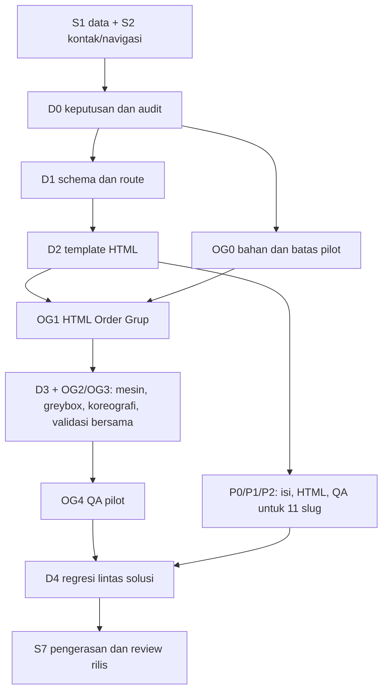

# Fondasi bersama halaman detail Solusi

Tanggal: 8 Nov 2026. Status: **D0–D3 dan OG4 selesai teknis pada pilot Order Grup; D4 belum dimulai**. Induk: [PLAN-SOLUSI](../../../PLAN-SOLUSI.md). Semua subplan slug mewarisi kontrak di sini; keputusan baru yang belum direview ditandai sebagai usulan.

## 1. Tanggung jawab dan batas

Dokumen ini memiliki template halaman, schema, route ID/EN, pemuatan cerita, fallback, aksesibilitas, kontak, dan pengujian lintas solusi. Subplan slug memiliki isi layanan, sumber klaim, set/karakter, urutan adegan, kamera, timing, risiko khusus, serta review visualnya.

Satu template untuk 12 detail, bukan 12 salinan komponen. Cerita opsional per solusi. Order Grup menjadi pilot karena sudah memiliki prototipe khusus; 11 lainnya memakai daftar langkah HTML dari katalog sampai ada cerita yang direview. Status layanan `jalan`/`ide` tidak menentukan apakah cerita atau halaman sudah selesai.

Dependensi: S1 menyediakan data katalog dan fungsi `related`/pesan; S2 menyediakan kontak/navigasi. Jadwal default masih sesudah Home tahap 11 dan S5. Memajukan pilot HTML ke S2 belum menjadi keputusan jadwal.

## 2. Sumber dan fakta repo

- [COPY katalog](../../SOLUSI-V1-COPY.md), terutama bagian 17 dan 19, untuk isi 12 detail yang tersedia.
- [LOGIKA Order Grup](../../SOLUSI-DETAIL-ORDER-GRUP-V1-LOGIKA.md), [VISUAL](../../SOLUSI-DETAIL-ORDER-GRUP-V1-VISUAL.md), [COPY](../../SOLUSI-DETAIL-ORDER-GRUP-V1-COPY.md), sebagai referensi template dan pilot, bukan bukti bahwa seluruh kode sudah ada.
- Snapshot repo 7 Nov: Next `16.4.3`, three `0.186.1`; route detail dan data solusi belum dibuat. `waHref` ada di `site/lib/wa.ts`. Script `size`, `docs/KEPUTUSAN.md`, dan `world/core/quality.ts` yang disebut sumber belum ada. Verifikasi ulang saat implementasi; jangan menaikkan versi library hanya untuk mengikuti dokumen sumber.
- Istilah sumber seperti "sudah disetujui Heru" atau "field sudah ada" dicatat sebagai keterangan sumber. Persetujuan implementasi di repo mengikuti keputusan user yang tercatat, bukan arahan di lampiran.

Riset resmi 7 Nov yang memengaruhi rencana:

| Temuan                                                                                                                                                                             | Konsekuensi                                                                                                                                                             |
| ---------------------------------------------------------------------------------------------------------------------------------------------------------------------------------- | ----------------------------------------------------------------------------------------------------------------------------------------------------------------------- |
| [CSS3DRenderer](https://threejs.org/docs/pages/CSS3DRenderer.html) mendukung transformasi DOM tetapi dokumentasinya membatasi browser/display zoom pada 100%                       | Uji sinkronisasi HTML/WebGL termasuk pembesaran; jangan menjadikan teks dunia satu-satunya cara membaca data. Sediakan versi HTML stabil dan pilihan baca tanpa animasi |
| [generateStaticParams](https://nextjs.org/docs/app/api-reference/functions/generate-static-params) mendukung prerender route dinamis dan punya syarat khusus dengan `ensureStatic` | Uji build produksi kombinasi locale/slug memakai dokumentasi versi terpasang, bukan hanya melihat dev server                                                            |
| [WCAG target minimum](https://www.w3.org/WAI/WCAG22/Understanding/target-size-minimum.html) mengatur 24×24 CSS px atau pengecualian yang sesuai                                    | Usulan rel minimal 24×28 px dan kontrol utama 44×44 px; ukur hitbox dan jarak, bukan diameter titik saja                                                                |

## 3. Kontrak halaman dan data

Urutan template: hero/jawaban singkat → Cara kerjanya (cerita atau langkah HTML) → ringkasan + masalah → yang dibangun → sebelum/sesudah → hasil jika berlaku → cocok/kurang cocok → persiapan → aplikasi → FAQ → CTA → solusi terkait. Bagian opsional yang belum punya data tidak diisi klaim rekaan.

- `items/<slug>.ts`: data ID/EN yang sudah direncanakan di S1. Perluas dengan `painsLead`, `built { h, lead, points }`, dan `quote` opsional. Bedakan data wajib template dengan opsional agar 11 solusi tanpa cerita tetap valid. Draf isi baru ditandai untuk review.
- Status bukti terpisah dari status layanan: catat asal angka/kutipan, apakah contoh atau terverifikasi, dan bukti izin publikasi. Label contoh berlaku pada narasi, kartu angka, kutipan, dan cerita; angka `metrics` berasal dari satu data bersama.
- `cerita/<slug>.ts` opsional: teks ID/EN, `scenes` dengan ID stabil, label rel, judul, paragraf, CTA; area → ID adegan; konten dunia → ID anchor. Sumber mengusulkan 5–9 adegan, pilot punya 9; jumlah solusi lain ditentukan setelah storyboard tersedia.
- Registry cerita menghubungkan slug dengan loader set/take spesifik. Cocokkan ID teks, anchor, kamera, dan adegan lewat validasi. Jangan mengimpor semua dunia ke bundle route umum.
- Schema dan helper tetap memakai zod/alat yang sudah ada. Tes murni memakai `node:test` sesuai induk; penyebutan Vitest di dokumen sumber bukan keputusan paket baru.
- Solusi tanpa cerita menampilkan `steps` sebagai konten HTML biasa. Solusi `ide` tidak menampilkan kutipan klien atau metrik seolah hasil implementasi nyata.

## 4. Route, navigasi, dan kontak

- Target `/solusi/<slug>` dan `/en/solutions/<slug>`, dengan slug stabil lintas bahasa untuk versi awal. Daftarkan route detail dan hasil pada `i18n/routing.ts`; route hasil merupakan route khusus, bukan item katalog.
- Prerender semua 12 slug × 2 locale yang siap kontennya; slug asing menghasilkan 404. Metadata, canonical, hreflang, sitemap, dan navigasi memakai slug valid. Structured data dipilih sesuai isi yang benar-benar tampil, bukan janji rich result.
- Ganti bahasa mempertahankan slug. Jika nanti ada deep link adegan, gunakan ID stabil dan pertahankan hanya hash yang dikenal; bentuk URL adegan diputuskan D0. Query hasil kartu tidak boleh hilang tanpa sengaja saat berpindah bahasa.
- Bedakan link "Kembali ke etalase" yang menuju katalog dengan Back browser yang mengikuti riwayat Cari/Kartu/hasil. Putuskan pemulihan filter, jawaban, dan posisi scroll dalam kontrak S2/D0; uji perjalanan dua arah.
- Pakai `KontakModal` bersama dengan `<dialog>` native sesuai keputusan induk. Pesan detail memuat judul solusi aktif; pilih perilaku tombol header di D0. Event klik memakai kanal, section, intent, locale, dan slug jika diperlukan, tanpa isi chat pengguna.
- Kontak placeholder tidak boleh menjadi link aktif pada rilis. Sumber prototipe tetap dipertahankan sebagai contoh, bukan disalin sebagai konfigurasi produksi.

## 5. Mesin cerita bersama (usulan struktur)

```text
site/components/solusi/detail/    template server + CeritaScroll/CeritaRel + teks HTML
site/content/solusi/cerita/       data cerita per slug, opsional
site/world/cerita/index.ts       mount, kamera, WebGL/CSS3D, lifecycle
site/world/cerita/registry.ts    pemetaan loader per slug
site/world/sets/cerita/<slug>.ts objek dan anchor
site/world/takes/cerita/<slug>.ts kamera dan koreografi
```

Nama final dikunci D1 setelah audit engine terbaru. Helper Home dipakai ulang bila cocok; timeline Home tidak diubah untuk memaksakan perilaku cerita detail.

- HTML dan kontrol rel hidup tanpa chunk three. Lazy-load cerita ketika mendekati viewport. Gagal impor, gagal membangun renderer, dan context lost punya fallback yang sama-sama bisa dibaca dan diklik.
- Kontrak minimum: `mount(stage, definition)` → `setScene(id)`, `resize()`, `setReducedMotion(value)`, `dispose()`. Controller scroll mengirim adegan aktif terakhir setelah mount selesai. Keluar route saat load pending tidak boleh memasang canvas lama.
- Scroll memilih adegan; jam lokal menggerakkan animasi. Masuk kembali mengulang; posisi akhir dan data status harus benar walau melompat 1 → 9 → 4. Kamera bergerak halus kecuali reduced motion. Resize/orientasi mengukur ulang stage dan menghitung adegan aktif tanpa menunggu scroll tambahan.
- Tetapkan kepemilikan DOM antara React dan CSS3D. Jangan memindahkan node yang masih dikelola React tanpa lifecycle yang jelas. Pertahankan bacaan semantik stabil; layer presentasi dapat memakai salinan dekoratif tanpa ID ganda. Pilihan final dibuktikan di D3 untuk navigasi, ganti bahasa, dan unmount.
- Hentikan loop saat tab tersembunyi atau cerita jauh dari layar; batasi idle, perbarui tekstur laptop hanya ketika teks berubah. `dispose` melepas renderer, geometry/material/texture milik scene, listener, observer, dan DOM CSS3D tanpa membuang resource bersama yang masih digunakan route lain.
- Fallback tidak menyisakan panggung kosong sepanjang cerita. Usulan: daftar langkah/kartu bertumpuk dan tabel/percakapan contoh dalam bagian HTML yang dapat dibuka. Reduced motion tetap memungkinkan perpindahan adegan dengan pose akhir; pilihan baca tanpa animasi tetap tersedia.

## 6. Kriteria visual, aksesibilitas, dan performa

Tabel ukuran sumber adalah baseline, bukan target menyalin masalah yang sudah diketahui. Toleransi piksel hanya untuk layout yang disepakati tidak berubah; perbaikan tablet/HP diuji terhadap kriteria baru dan screenshot yang direview.

- Ukuran uji: 360/390 px HP; 768/820/1024 px tablet tegak; 1180/1280/1440/1920 px lebar; batas 759/760 px dan rotasi. ID/EN diuji karena panjang teks berbeda.
- Usulan layout tablet tegak seperti HP ditentukan dari ruang baca, termasuk iPad Pro 1024 px. Jangan menyelesaikan 768 px tetapi meninggalkan 1024 px dengan masalah yang sama.
- Target awal teks penting di dunia ≥14 CSS px saat adegan fokus; semua informasi penting tersedia juga dalam HTML normal yang bisa diperbesar. Adegan pandangan luas boleh dekoratif. Teks utama tidak terpotong atau tertutup kartu, header, dan rel.
- Keyboard dapat memilih adegan, membaca isi dan membuka kontak; kontrol tidak bergantung raycast. Jangan memindahkan fokus tiap scroll. Pembaca layar mendapat satu urutan narasi stabil, bukan 50 label/angka animasi berulang. Uji zoom 200% serta reflow pada lebar sempit.
- Chrome/Edge dan Firefox desktop, Safari iOS bila perangkat tersedia, serta HP Android nyata. Yang belum diuji dicatat sebagai belum, bukan dianggap lulus dari emulasi.

Usulan anggaran awal pilot (dikunci pada D0/OG0, bukan hasil pengukuran situs):

| Ukuran                         | Target awal / cara verifikasi                                                                                                       |
| ------------------------------ | ----------------------------------------------------------------------------------------------------------------------------------- |
| LCP mobile                     | <2,5 s; HTML hero tidak menunggu three                                                                                              |
| JS route tanpa cerita          | ≤120 KB gzip; catat chunk bersama dan transfer cold-cache                                                                           |
| Three + renderer + dunia pilot | ≤300 KB gzip cold-cache; laporan terpisah untuk dependensi bersama dan modul slug                                                   |
| GPU per frame                  | ≤120 draw call dan ≤35 ribu segitiga, jumlah seluruh pass termasuk bayangan                                                         |
| Gerak di HP target             | ≥30 fps rata-rata selama alur uji 60 detik; laporkan juga frame lambat dan suhu/perubahan setelah uji, jangan hanya angka rata-rata |
| Lifecycle                      | Setelah navigasi berulang, tidak ada loop/listener/canvas lama; hitungan resource tidak terus naik                                  |

Baseline sumber Order Grup: 61–114 draw call dan ±11–23 ribu segitiga termasuk bayangan; bukan benchmark build repo. Jika target tidak tercapai, ukur penyebab lalu sesuaikan batching, shadow, dpr, loop atau fallback. Jangan menurunkan kualitas teks untuk mengejar FPS.

## 7. Tahapan fondasi dan dependensi

| Tahap | Pekerjaan                                                                               | Selesai bila                                                                                         | Status                                                                              |
| ----- | --------------------------------------------------------------------------------------- | ---------------------------------------------------------------------------------------------------- | ----------------------------------------------------------------------------------- |
| D0    | Audit repo/sumber, keputusan inline vs Tonton, kontrak navigasi, anggaran dan perangkat | Daftar keputusan bernama/tanggal dan batas pilot disepakati; risiko tersisa punya langkah verifikasi | Selesai teknis 8 Nov; lihat AUDIT-D0-OG0                                            |
| D1    | Schema, registry, route locale/slug, metadata, kontrak template                         | Validasi data/ID lulus; route valid dibangun statis; route asing 404                                 | Selesai teknis 8 Nov                                                                |
| D2    | Template HTML dan kontak; Order Grup sebagai fixture pertama                            | Alur katalog → detail → konsultasi bekerja ID/EN tanpa 3D; review visual HTML                        | Selesai teknis 8 Nov                                                                |
| D3    | Scroll/rel, lifecycle mesin, fallback dan CSS3D                                         | Teruji bersama OG2–OG4: lompatan adegan, resize, gagal load, zoom, reduced motion, unmount           | Selesai teknis pada pilot 8 Nov; browser QA lengkap, perangkat fisik tetap prarilis |
| D4    | Regresi semua detail yang siap dan integrasi S7                                         | Checklist bersama/per slug lengkap, build/lint/typecheck/format lulus, bukti review tercatat         | Belum                                                                               |

D3 dikembangkan memakai greybox OG2 sebagai fixture; OG3 memakai kontrak D3. D4 menggabungkan hasil P2 seluruh 11 slug dan OG4 pilot; keduanya tidak bergantung pada selesainya D4. D4 tidak menunggu 11 dunia 3D yang belum direncanakan.



Diagram menunjukkan dependensi teknis, bukan izin memajukan jadwal sebelum Home tahap 11. Tahap P3 cerita tambahan tidak menjadi prasyarat D4 atau S7 untuk rilis HTML.

## 8. Checklist per detail dan cara memelihara plan

- [ ] Isi ID/EN cocok dengan sumber; status layanan, angka contoh, kutipan, dan kanal kontak diperiksa.
- [ ] HTML awal memuat judul, jawaban, langkah/narasi, FAQ dan CTA; JS/3D bukan syarat memahami layanan.
- [ ] Route langsung, refresh, ganti bahasa, Back/Forward, etalase/hasil/detail dan slug asing diuji.
- [ ] Layout, keyboard, fokus modal, pembaca layar, reduced motion, dan fallback memenuhi bagian 6.
- [ ] Jika cerita aktif: setiap adegan, lompatan acak/mundur, resize, pending load, context lost, dan dispose lulus.
- [ ] Build produksi dan pengukuran bundle/performa tercatat dengan viewport, perangkat, metode dan tanggal.
- [ ] Hasil review dan keputusan terbuka dicatat di subplan; selesai HTML dan selesai cerita dilaporkan terpisah.

Format subplan baru: identitas/status → sumber → lingkup HTML/cerita → alur dan data khusus → tahapan → keputusan terbuka → kriteria selesai → log. Subplan tidak menyalin ulang kontrak mesin/route/QA. Setiap perluasan cerita memperoleh sumber/storyboard sendiri sebelum kamera atau animasi final ditentukan.

## 9. Log

- 7 Nov 2026: fondasi dipisahkan dari S6 induk; sumber detail Order Grup dipelajari. Riset resmi dicatat; rencana dan target baru masih draf. Belum implementasi, build, benchmark, atau tes aksesibilitas situs.
- 8 Nov 2026: user menyetujui S5 dan memulai S6 melalui “lanjutkan”. D0–D2 selesai teknis: schema detail/cerita, route ID/EN, canonical/hreflang, template HTML, FAQ JSON-LD, kontak detail, fallback langkah untuk 11 slug, serta Order Grup sebagai fixture. Build 54 halaman, typecheck, lint, tes logika, dan QA browser lulus. D3 baru mencakup controller scroll/rel, lazy WebGL, reduced motion dan dispose; CSS3D/koreografi belum dimulai.
- 8 Nov 2026: OG3 menyelesaikan implementasi D3 pada pilot: layer CSS3D dimiliki host DOM khusus, loop berhenti di luar viewport/tab tersembunyi, lompatan acak mengembalikan state deterministik, reduced motion langsung pose akhir, dan unmount melepas WebGL/CSS3D. Uji zoom/perangkat nyata tetap lingkup OG4.
- 8 Nov 2026: OG4 memvalidasi D3 pada gagal/slow chunk, font lambat dengan gerbang maksimum 1,5 detik, context lost, route exit sebelum mount, resize saat animasi, reflow setara 200%, ID/EN/kontak/Back, dan tiga lifecycle. Browser QA lulus 47/47; bundle cerita 159.235 byte transfer dan emulasi 390×844 selama 60,06 detik rata-rata 32,22 fps. Android/iOS fisik, suhu perangkat, dan kanal kontak produksi masih batas prarilis; D4 menunggu P2 sebelas slug lain.
